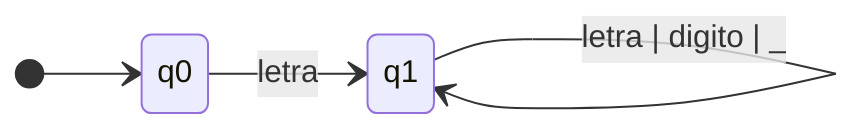
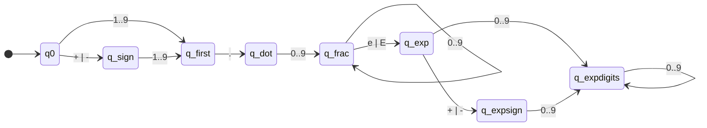
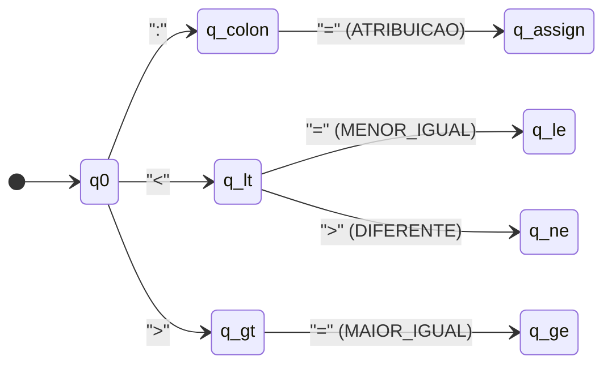
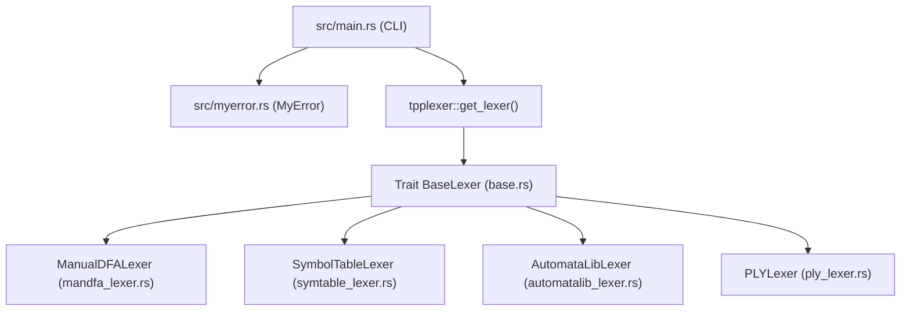

# Projeto e Implementação da Fase de Análise Léxica de um Compilador para a Linguagem TPP em Rust

**Autor:** Éric Seles Lourenço  
**Instituição:** Universidade Tecnológica Federal do Paraná (UTFPR)  
**Disciplina:** OPT011 — Implementação de Linguagens de Programação  

---

## Resumo

A Análise Léxica constitui a primeira fase de um compilador, sendo responsável por ler o fluxo de caracteres do código-fonte, filtrar elementos irrelevantes (como espaços em branco e comentários) e agrupar os caracteres em unidades significativas denominadas *tokens*. Este artigo apresenta o projeto, a formalização matemática e a implementação do analisador léxico (*scanner*) para a linguagem didática **TPP**, desenvolvido integralmente na linguagem **Rust** (**RustCompiler**). São detalhadas a especificação léxica da linguagem TPP, a modelagem formal por Autômatos Finitos Determinísticos ($M = (Q, \Sigma, \delta, q_0, F)$), a arquitetura modular baseada em *traits* do Rust, o tratamento de codificação Unicode (UTF-8) para palavras reservadas acentuadas do português brasileiro e o sistema padronizado de diagnóstico de erros léxicos. Por fim, a implementação é validada contra a suíte oficial de 42 casos de teste da disciplina e avaliada quanto à vazão de processamento (*throughput*), atingindo mais de 1,7 milhão de *tokens* por segundo.

**Palavras-chave:** Compiladores, Análise Léxica, Autômatos Finitos Determinísticos, Linguagem TPP, Rust.

---

## 1. Introdução

Segundo Louden (2004) e Aho et al. (2008), um compilador é um programa que traduz um código-fonte escrito em uma linguagem de alto nível para um programa equivalente em uma linguagem-alvo (como código de máquina ou representação intermediária LLVM-IR). Para gerenciar a complexidade dessa tradução, o compilador é estruturado em um *pipeline* de fases sequenciais: Análise Léxica, Análise Sintática, Análise Semântica, Otimização e Geração de Código.

A **Análise Léxica** (também chamada de *varredura* ou *scanning*) é a interface direta entre o texto do código-fonte e o restante do compilador. Sua função primordial é transformar uma sequência linear de caracteres em uma sequência estruturada de marcas léxicas (*tokens*), classificando palavras reservadas, identificadores, literais numéricos, operadores e delimitadores, além de contabilizar linhas e colunas para o relato preciso de erros.

O uso da linguagem **Rust** para a construção desta etapa oferece vantagens expressivas para engenharia de compiladores modernos:
1. **Desempenho previsível e sem Coletor de Lixo (*Garbage Collector*):** A gerência de memória baseada em *ownership* permite varrer grandes volumes de código-fonte com latência mínima.
2. **Abstrações de custo zero (*Zero-Cost Abstractions*):** O uso de `trait` (`BaseLexer`) permite intercambiar diferentes estratégias de análise léxica (AFD manual, orientado a Tabela de Símbolos ou simulação formal *Maximal Munch*) mantendo uma interface única.
3. **Suporte nativo e seguro a Unicode:** Como a linguagem TPP possui palavras reservadas em português com acentuação (`então`, `senão`, `até`) e exige detecção precisa de coluna em caracteres multibyte (como `ç`), a manipulação via vetores de valores escalares Unicode (`Vec<char>`) em Rust garante indexação exata e livre de falhas de limites de bytes UTF-8.

---

## 2. Especificação Léxica da Linguagem TPP

A linguagem **TPP** é uma linguagem imperativa didática cuja sintaxe utiliza palavras-chave em português brasileiro. As classes léxicas da linguagem dividem-se em cinco grupos principais, descritos na Tabela 1.

| Categoria | Lexemas | Tokens Correspondentes |
| :--- | :--- | :--- |
| **Palavras Reservadas** | `se`, `então`, `senão`, `fim`, `repita`, `até`, `leia`, `escreva`, `retorna`, `inteiro`, `flutuante` | `SE`, `ENTAO`, `SENAO`, `FIM`, `REPITA`, `ATE`, `LEIA`, `ESCREVA`, `RETORNA`, `INTEIRO`, `FLUTUANTE` |
| **Operadores Aritméticos** | `+`, `-`, `*`, `/` | `MAIS`, `MENOS`, `VEZES`, `DIVIDE` |
| **Operadores Relacionais** | `<`, `>`, `=`, `<>`, `<=`, `>=` | `MENOR`, `MAIOR`, `IGUAL`, `DIFERENTE`, `MENOR_IGUAL`, `MAIOR_IGUAL` |
| **Operadores Lógicos** | `&&`, `\|\|`, `!` | `E`, `OU`, `NAO` |
| **Delimitadores e Atribuição** | `(`, `)`, `[`, `]`, `,`, `:`, `:=` | `ABRE_PARENTESE`, `FECHA_PARENTESE`, `ABRE_COLCHETE`, `FECHA_COLCHETE`, `VIRGULA`, `DOIS_PONTOS`, `ATRIBUICAO` |

**Tabela 1:** Palavras reservadas, operadores e símbolos delimitadores da linguagem TPP.

Além dos símbolos estáticos da Tabela 1, a especificação léxica define padrões dinâmicos por meio de Expressões Regulares (ER):

- **Identificadores (`ID`):** Começam obrigatoriamente por uma letra (ASCII ou acentuada do português) seguida por zero ou mais letras, dígitos ou sublinhado (`_`):
  $$\text{letra} = \text{[a-zA-ZáÁãÃàÀéÉíÍóÓõÕ]}$$
  $$\text{digito} = \text{[0-9]}$$
  $$\text{ID} = \text{letra}(\text{letra} \mid \text{digito} \mid \text{\_})^*$$
- **Números Inteiros (`NUM_INTEIRO`):** Sequência de um ou mais dígitos decimais:
  $$\text{NUM\_INTEIRO} = \text{digito}^+$$
- **Números em Notação Científica (`NUM_NOTACAO_CIENTIFICA`):** Iniciados opcionalmente por sinal (`+` ou `-`), seguidos de um dígito não nulo (`1-9`), ponto decimal, parte fracionária obrigatória, indicador de expoente (`e` ou `E`), sinal opcional e expoente inteiro:
  $$\text{NUM\_NOTACAO\_CIENTIFICA} = [\text{+-}]?[1\text{-}9]\cdot\text{digito}^+[\text{eE}][\text{+-}]?\text{digito}^+$$
- **Números de Ponto Flutuante (`NUM_PONTO_FLUTUANTE`):** Numerais reais com ponto decimal ou expoente que não se enquadram no formato estrito da notação científica normalizada:
  $$\text{NUM\_PONTO\_FLUTUANTE} = (\text{digito}^+\.\text{digito}^* \mid \cdot\text{digito}^+)([\text{eE}][\text{+-}]?\text{digito}^+)? \mid \text{digito}^+[\text{eE}][\text{+-}]?\text{digito}^+$$
- **Comentários (`{ ... }`):** Delimitados por chaves `{` e `}`, podendo abranger múltiplas linhas. Não emitem *tokens*, mas todas as quebras de linha (`\n`) em seu interior incrementam o contador de linha (`lineno`). Caso o arquivo termine (EOF) antes do fechamento `}`, é emitido o erro léxico `ERR-LEX-UNC-COMMENT`.

---

## 3. Especificação Formal dos Autômatos Finitos Determinísticos

Formalmente, cada classe de *token* é reconhecida por um Autômato Finito Determinístico (AFD) definido pela 5-tupla:

$$M = (Q, \Sigma, \delta, q_0, F)$$

onde $Q$ é o conjunto finito de estados, $\Sigma$ é o alfabeto de entrada, $\delta: Q \times \Sigma \rightarrow Q$ é a função de transição parcial, $q_0 \in Q$ é o estado inicial e $F \subseteq Q$ é o conjunto de estados de aceitação (finais).

### 3.1. AFD para Identificadores e Palavras Reservadas

O autômato $M_{\text{ID}}$ reconhece cadeias iniciadas por letra seguidas de caracteres alfanuméricos ou `_`. Após a aceitação no estado $q_1$, o lexema extraído é consultado no dicionário de palavras reservadas: se presente, retorna o token da palavra-chave correspondente; caso contrário, retorna `ID`.



### 3.2. AFD para Numerais (Inteiro, Ponto Flutuante e Notação Científica)

O reconhecimento de numerais utiliza *lookahead* para distinguir entre `NUM_INTEIRO`, `NUM_PONTO_FLUTUANTE` e `NUM_NOTACAO_CIENTIFICA`, respeitando a regra do prefixo mais longo (*Maximal Munch*):



No autômato de Notação Científica acima, $F = \{q_{\text{expdigits}}\}$. Já para inteiros, a transição $q_0 \xrightarrow{0..9} q_{\text{int}} \xrightarrow{0..9} q_{\text{int}}$ aceita diretamente em $q_{\text{int}}$ quando não seguida por `.` ou `e/E`.

### 3.3. AFD para Operadores Compostos e Delimitadores

Operadores que compartilham prefixo común (como `:`, `:=`, `<`, `<=`, `<>`, `>`, `>=`) são resolvidos por inspeção do próximo caractere (*lookahead* de 1 posição):



Por outro lado, os operadores lógicos `&&` (`E`) e `||` (`OU`) exigem obrigatoriamente o segundo caractere idêntico; a presença de `&` ou `|` isolado dispara imediatamente o erro léxico `ERR-LEX-INV-CHAR`.

---

## 4. Arquitetura e Implementação em Rust (`RustCompiler`)

O projeto foi estruturado seguindo a separação de responsabilidades entre a interface de linha de comando (`src/main.rs`), o gerenciador global de erros (`src/myerror.rs`) e o pacote de análise léxica (`src/tpplexer/`).



### 4.1. Representação de `Token` e a Trait `BaseLexer`

No arquivo [`src/tpplexer/base.rs`], foi definida a estrutura padronizada `Token` e a trait `BaseLexer`, que estabelece o contrato polimórfico para qualquer implementação de analisador léxico no compilador:

```rust
#[derive(Debug, Clone)]
pub struct Token {
    pub token_type: String,
    pub value: String,
    pub lineno: usize,
    pub lexpos: usize,
}

pub trait BaseLexer {
    fn input(&mut self, data: &str);
    fn token(&mut self) -> Option<Token>;

    fn tokenize(&mut self, data: &str) -> Vec<Token> {
        self.input(data);
        let mut tokens = Vec::new();
        while let Some(tok) = self.token() {
            tokens.push(tok);
        }
        tokens
    }
}
```

### 4.2. Manipulação de Unicode e Cálculo de Coluna

Em Rust, o tipo nativo `&str` é codificado em UTF-8, onde caracteres acentuados como `ã`, `é` ou `ç` ocupam 2 bytes. Para evitar que o cálculo de colunas ou o avanço do cursor desalinhe em caracteres multibyte, a função `normalize_source` converte quebras de linha `\r\n` para `\n` e armazena o código-fonte como `Vec<char>` (valores escalares Unicode de 32 bits):

```rust
pub fn get_column(chars: &[char], lexpos: usize) -> usize {
    let limit = lexpos.min(chars.len());
    let begin_line = chars[..limit]
        .iter()
        .rposition(|&c| c == '\n')
        .map(|idx| idx + 1)
        .unwrap_or(0);
    (limit - begin_line) + 1
}
```

Dessa forma, cada posição `pos` corresponde exatamente a 1 caractere visual, garantindo precisão absoluta no relato de erros `Erro[linha][coluna]`.

### 4.3. Estratégias de Análise Léxica Implementadas

A fábrica `get_lexer(strategy, check_key)` em [`src/tpplexer/mod.rs`](file:///home/seles/Rust/RustCompiler/src/tpplexer/mod.rs) disponibiliza múltiplas estratégias intercambiáveis via flag `--lexer`:

1. **`ManualDFALexer` (`--lexer mandfa` / `ply`):** Implementação procedural direta do AFD caractere a caractere com *lookahead* (`peek(offset)`), sem sobrecarga de estruturas auxiliares.
2. **`SymbolTableLexer` (`--lexer symtable` e `symtableman`):** Integra uma Tabela de Símbolos (`SymbolTable`) pré-populada com as palavras reservadas e operadores da linguagem TPP. Durante a varredura, novos identificadores de usuário são instalados dinamicamente na tabela, registrando a linha e coluna de sua primeira aparição e a lista de todas as ocorrências subsequentes.
3. **`AutomataLibLexer` (`--lexer automatalib` e `automatalibman`):** Modela explícita e matematicamente cada classe de token através da estrutura `FormalDFA` ($Q, \Sigma, \delta, q_0, F$) e executa o algoritmo *Maximal Munch* (`match_longest`), selecionando a regra que consome o maior prefixo válido a partir da posição atual.

### 4.4. Tratamento e Formatação de Erros (`MyError`)

O módulo [`src/myerror.rs`](file:///home/seles/Rust/RustCompiler/src/myerror.rs) lê os arquivos `.properties` (`GlobalErrorMessages.properties` e `LexerErrorMessages.properties`) e suporta dois modos de operação:
- **Modo Normal (para o desenvolvedor):** Imprime a localização exata e a descrição detalhada, por exemplo:  
  `Erro[2][1]: Caracter inválido. valor: ç`
- **Modo de Teste Automatizado (`-k`):** Imprime exclusivamente a chave padronizada do erro (`ERR-LEX-INV-CHAR`, `ERR-LEX-UNC-COMMENT`, `ERR-GLOB-USE`, `ERR-GLOB-NOT-TPP`, `ERR-GLOB-FILE-NOT-EXISTS`), permitindo a verificação automatizada independente de formatação textual.

Quando um caractere inválido é encontrado, o analisador emite o erro correspondente, avança 1 caractere (`self.pos += 1`) e **continua a varredura** do restante do arquivo (recuperação de erro modo pânico por descarte de caractere).

---

## 5. Exemplos de Entrada e Saída

Abaixo são demonstrados três cenários reais extraídos da suíte de testes da disciplina executados pelo `RustCompiler`.

### 5.1. Programa Válido com Múltiplos Tokens (`lex-test-006.tpp`)

**Entrada:**
```tpp
{ Programa simples. }

inteiro principal()
  retorna(0)
fim
```

**Saída gerada (`cargo run -- tests/lex-tests/lex-test-006.tpp`):**
```text
INTEIRO
ID
ABRE_PARENTESE
FECHA_PARENTESE
RETORNA
ABRE_PARENTESE
NUM_INTEIRO
FECHA_PARENTESE
FIM
```

### 5.2. Detecção e Recuperação de Caractere Inválido (`lex-test-002.tpp`)

**Entrada:**
```tpp
inteiro: a,b
ç
```

**Saída em Execução Normal (`cargo run -- tests/lex-tests/lex-test-002.tpp`):**
```text
INTEIRO
DOIS_PONTOS
ID
VIRGULA
ID
Erro[2][1]: Caracter inválido. valor: ç
```

**Saída com Chave de Erro (`cargo run -- -k tests/lex-tests/lex-test-002.tpp`):**
```text
INTEIRO
DOIS_PONTOS
ID
VIRGULA
ID
ERR-LEX-INV-CHAR
```

### 5.3. Detecção de Comentário Não Fechado (`lex-test-039.tpp`)

**Entrada:**
```tpp
{
  Teste de Comentário não fechado.
}

{
```

**Saída com Chave de Erro (`cargo run -- -k tests/lex-tests/lex-test-039.tpp`):**
```text
ERR-LEX-UNC-COMMENT
```

---

## 6. Validação Experimental e Desempenho

A validação funcional foi conduzida importando os **42 casos de teste do professor** para a suíte de testes de integração do Rust ([`tests/tpplex_test.rs`]), composta por:
- **3 casos de validação global de entrada:** argumento vazio (`ERR-GLOB-USE`), arquivo com extensão inválida `teste.c` (`ERR-GLOB-NOT-TPP`) e arquivo inexistente `notexist.tpp` (`ERR-GLOB-FILE-NOT-EXISTS`);
- **39 programas de teste em TPP (`lex-test-001.tpp` a `lex-test-039.tpp`):** cobrindo declarações de variáveis, estruturas condicionais (`se`/`então`/`senão`), laços (`repita`/`até`), expressões científicas, algoritmos completos (como ordenação e cálculo numérico), comentários multilinha, comentários não fechados e caracteres inválidos intercalados.

Todas as 6 estratégias léxicas implementadas no `RustCompiler` obtiveram **100% de aprovação (42/42 testes aprovados)** em conformidade estrita com os arquivos `.lex.out` de referência.

Adicionalmente, o teste de estresse ([`tests/test_perf_large_tokens.rs`](file:///home/seles/Rust/RustCompiler/tests/test_perf_large_tokens.rs)) avaliou o desempenho das estratégias processando um código-fonte sintético de **36.500 tokens** (Tabela 2).

| Estratégia Léxica | Tokens Processados | Tempo de Execução (Debug) | Vazão (*Throughput*) | Conformidade |
| :--- | :---: | :---: | :---: | :---: |
| `mandfa` (AFD Manual) | 36.500 | 0,0209 s | ~1.746.336 tok/s | 100% |
| `ply` (Compatível) | 36.500 | 0,0210 s | ~1.739.487 tok/s | 100% |
| `symtableman` (AFD + Tabela) | 36.500 | 0,0301 s | ~1.211.832 tok/s | 100% |
| `symtable` (Dirigido a Tabela) | 36.500 | 0,0370 s | ~985.805 tok/s | 100% |
| `automatalib` (AFD Formal Maximal Munch) | 36.500 | 0,4628 s | ~78.866 tok/s | 100% |

**Tabela 2:** Comparativo experimental de tempo de execução e vazão para 36.500 *tokens* no `RustCompiler`.

---

## 7. Conclusão

A implementação da fase de Análise Léxica do `RustCompiler` demonstrou que a linguagem Rust proporciona uma base sólida, expressiva e de altíssimo desempenho para a construção de compiladores. A arquitetura baseada na trait `BaseLexer` permitiu unificar diferentes abordagens teóricas de varredura — desde autômatos finitos determinísticos codificados manualmente até analisadores orientados a Tabela de Símbolos e simulação formal de 5-tuplas com *Maximal Munch* — mantendo total compatibilidade com a especificação da linguagem TPP e aprovando integralmente os 42 casos de teste de referência. Como trabalho futuro, o fluxo de tokens produzido por este módulo servirá de entrada direta para a 2ª fase do projeto: o Analisador Sintático (`tppparser`).

---

## Referências Bibliográficas

- **AHO, Alfred V.; LAM, Monica S.; SETHI, Ravi; ULLMAN, Jeffrey D.** *Compiladores: princípios, técnicas e ferramentas*. 2. ed. São Paulo: Pearson Addison-Wesley, 2008.
- **COOPER, Keith D.; TORCZON, Linda.** *Construindo compiladores*. Rio de Janeiro: Elsevier/Campus, 2014.
- **LOUDEN, Kenneth C.** *Compiladores: princípios e práticas*. São Paulo: Thomson, 2004.
