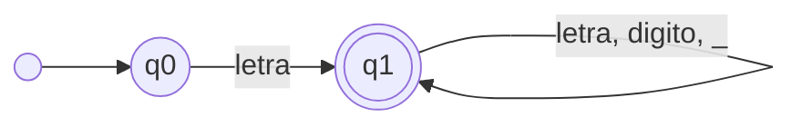
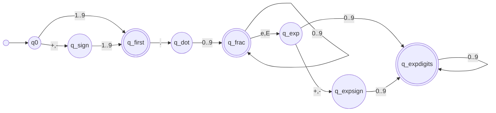
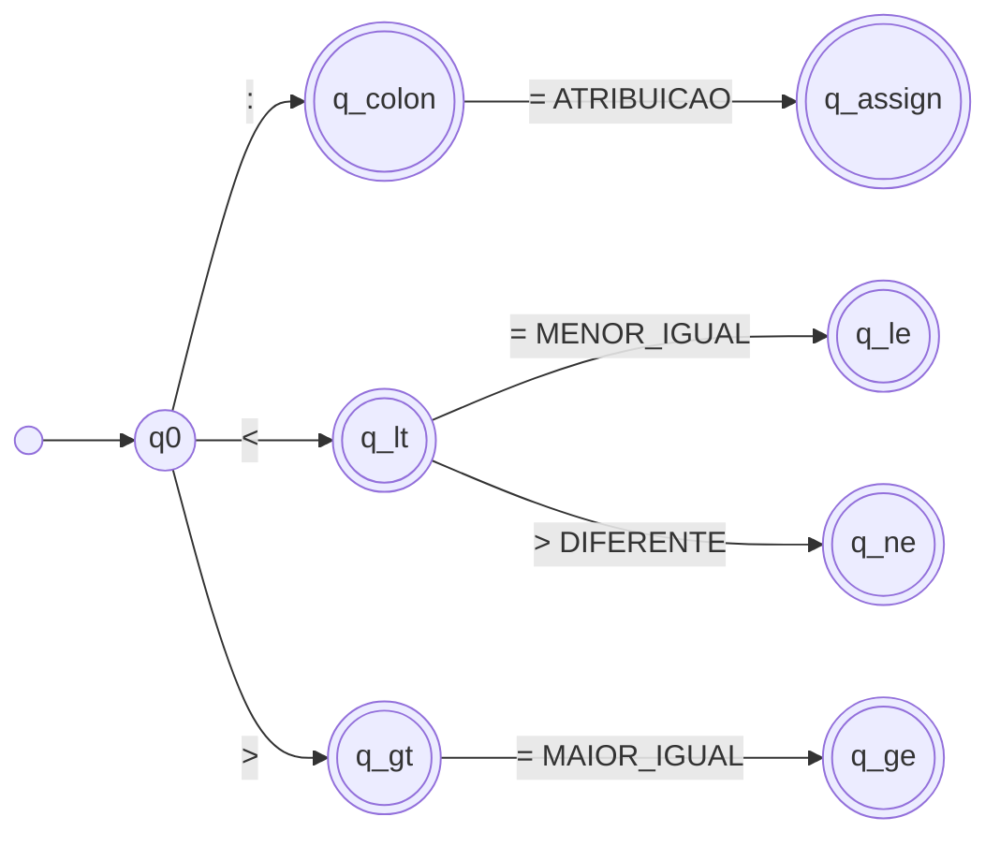
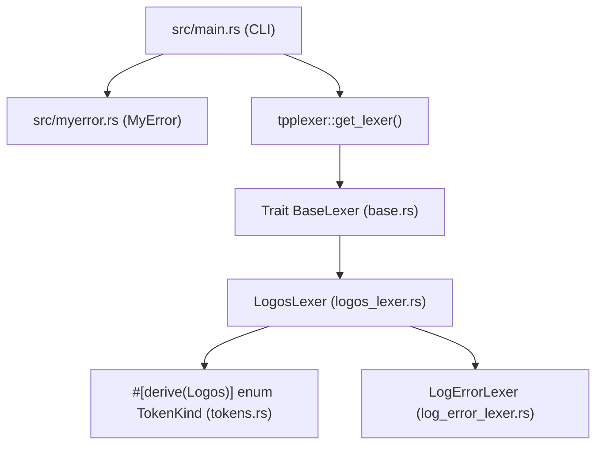

# Projeto e Implementação da Fase de Análise Léxica de um Compilador para a Linguagem TPP em Rust

**Autor:** Éric Seles Lourenço  
**Instituição:** Universidade Tecnológica Federal do Paraná (UTFPR)  
**Disciplina:** OPT011 — Implementação de Linguagens de Programação  

---

## Resumo

A Análise Léxica constitui a primeira fase de um compilador, sendo responsável por ler o fluxo de caracteres do código-fonte, filtrar elementos irrelevantes (como espaços em branco e comentários) e agrupar os caracteres em unidades significativas denominadas *tokens*. Este artigo apresenta o projeto, a formalização matemática e a implementação do analisador léxico (*scanner*) para a linguagem didática **TPP**, desenvolvido na linguagem **Rust** (**RustCompiler**) utilizando o crate **`logos`** — o padrão do ecossistema Rust para geração de analisadores léxicos em tempo de compilação. São detalhadas a especificação léxica da linguagem TPP, a modelagem formal por Autômatos Finitos Determinísticos ($M = (Q, \Sigma, \delta, q_0, F)$), a compilação declarativa de expressões regulares via macro procedural `#[derive(Logos)]`, o tratamento de codificação Unicode (UTF-8) para palavras reservadas acentuadas do português brasileiro e o sistema padronizado de diagnóstico de erros léxicos. Por fim, a implementação é validada contra a suíte oficial de 42 casos de teste da disciplina.

**Palavras-chave:** Compiladores, Análise Léxica, Autômatos Finitos Determinísticos, Linguagem TPP, Rust, Logos.

---

## 1. Introdução

Segundo Louden (2004) e Aho et al. (2008), um compilador é um programa que traduz um código-fonte escrito em uma linguagem de alto nível para um programa equivalente em uma linguagem-alvo (como código de máquina ou representação intermediária LLVM-IR). Para gerenciar a complexidade dessa tradução, o compilador é estruturado em um *pipeline* de fases sequenciais: Análise Léxica, Análise Sintática, Análise Semântica, Otimização e Geração de Código.

A **Análise Léxica** (também chamada de *varredura* ou *scanning*) é a interface direta entre o texto do código-fonte e o restante do compilador. Sua função primordial é transformar uma sequência linear de caracteres em uma sequência estruturada de marcas léxicas (*tokens*), classificando palavras reservadas, identificadores, literais numéricos, operadores e delimitadores, além de contabilizar linhas e colunas para o relato preciso de erros.

O uso da linguagem **Rust** aliado ao crate **`logos`** para a construção desta etapa oferece vantagens expressivas para engenharia de compiladores modernos:
1. **Geração de AFD em Tempo de Compilação (`#[derive(Logos)]`):** Diferente de analisadores baseados em avaliação de expressões regulares em tempo de execução, o `logos` converte declarativamente todos os padrões `#[token]` e `#[regex]` em um Autômato Finito Determinístico otimizado por tabelas de salto (*jump tables* e *lookup tables*) durante a compilação.
2. **Desempenho previsível e sem Coletor de Lixo (*Garbage Collector*):** A gerência de memória baseada em *ownership* e fatias UTF-8 (`&str`) permite varrer grandes volumes de código-fonte com latência mínima.
3. **Suporte nativo e seguro a Unicode:** Como a linguagem TPP possui palavras reservadas em português com acentuação (`então`, `senão`, `até`) e exige detecção precisa de coluna em caracteres multibyte (como `ç`), o `logos` opera diretamente sobre fatias UTF-8 válidas garantidas pelo sistema de tipos do Rust.

---

## 2. Especificação Léxica da Linguagem TPP

A linguagem **TPP** é uma linguagem imperativa didática cuja sintaxe utiliza palavras-chave em português brasileiro. As classes léxicas da linguagem dividem-se em cinco grupos principais, descritos na Tabela 1.

| Categoria | Lexemas | Tokens Correspondentes |
| :--- | :--- | :--- |
| **Palavras Reservadas** | `se`, `então`, `senão`, `fim`, `repita`, `até`, `leia`, `escreva`, `retorna`, `inteiro`, `flutuante` | `SE`, `ENTAO`, `SENAO`, `FIM`, `REPITA`, `ATE`, `LEIA`, `ESCREVA`, `RETORNA`, `INTEIRO`, `FLUTUANTE` |
| **Operadores Aritméticos** | `+`, `-`, `*`, `/` | `MAIS`, `MENOS`, `VEZES`, `DIVIDE` |
| **Operadores Relacionais** | `<`, `>`, `=`, `<>`, `<=`, `>=` | `MENOR`, `MAIOR`, `IGUAL`, `DIFERENTE`, `MENOR_IGUAL`, `MAIOR_IGUAL` |
| **Operadores Lógicos** | `&&`, `\|\|`, `!` | `E`, `OU`, `NAO` |
| **Delimitadores e Atribuição** | `(`, `)`, `[`, `]`, `,`, `:`, `:=` | `ABRE_PARENTESE`, `FECHA_PARENTESE`, `ABRE_COLCHETE`, `FECHA_COLCHETE`, `VIRGULA`, `DOIS_PONTOS`, `ATRIBUICAO` |

**Tabela 1:** Palavras reservadas, operadores e símbolos delimitadores da linguagem TPP.

Além dos símbolos estáticos da Tabela 1, a especificação léxica define padrões dinâmicos por meio de Expressões Regulares (ER):

- **Identificadores (`ID`):** Começam obrigatoriamente por uma letra (ASCII ou acentuada do português) seguida por zero ou mais letras, dígitos ou sublinhado (`_`):
  $$\text{letra} = \text{[a-zA-ZáÁãÃàÀéÉíÍóÓõÕ]}$$
  $$\text{digito} = \text{[0-9]}$$
  $$\text{ID} = \text{letra}(\text{letra} \mid \text{digito} \mid \text{\_})^*$$
- **Números Inteiros (`NUM_INTEIRO`):** Sequência de um ou mais dígitos decimais:
  $$\text{NUM\_INTEIRO} = \text{digito}^+$$
- **Números em Notação Científica (`NUM_NOTACAO_CIENTIFICA`):** Iniciados opcionalmente por sinal (`+` ou `-`), seguidos de um dígito não nulo (`1-9`), ponto decimal, parte fracionária obrigatória, indicador de expoente (`e` ou `E`), sinal opcional e expoente inteiro:
  $$\text{NUM\_NOTACAO\_CIENTIFICA} = [\text{+-}]?[1\text{-}9]\cdot\text{digito}^+[\text{eE}][\text{+-}]?\text{digito}^+$$
- **Números de Ponto Flutuante (`NUM_PONTO_FLUTUANTE`):** Numerais reais com ponto decimal ou expoente que não se enquadram no formato estrito da notação científica normalizada:
  $$\text{NUM\_PONTO\_FLUTUANTE} = (\text{digito}^+\.\text{digito}^* \mid \cdot\text{digito}^+)([\text{eE}][\text{+-}]?\text{digito}^+)? \mid \text{digito}^+[\text{eE}][\text{+-}]?\text{digito}^+$$
- **Comentários (`{ ... }`):** Delimitados por chaves `{` e `}`, podendo abranger múltiplas linhas. Não emitem *tokens*, mas todas as quebras de linha (`\n`) em seu interior incrementam o contador de linha (`lineno`). Caso o arquivo termine (EOF) antes do fechamento `}`, é emitido o erro léxico `ERR-LEX-UNC-COMMENT`.

---

## 3. Especificação Formal dos Autômatos Finitos Determinísticos

Formalmente, cada classe de *token* compilada pelo `logos` é reconhecida por um Autômato Finito Determinístico (AFD) definido pela 5-tupla:

$$M = (Q, \Sigma, \delta, q_0, F)$$

onde $Q$ é o conjunto finito de estados, $\Sigma$ é o alfabeto de entrada, $\delta: Q \times \Sigma \rightarrow Q$ é a função de transição parcial, $q_0 \in Q$ é o estado inicial e $F \subseteq Q$ é o conjunto de estados de aceitação (finais).

### 3.1. AFD para Identificadores e Palavras Reservadas

O autômato $M_{\text{ID}}$ reconhece cadeias iniciadas por letra seguidas de caracteres alfanuméricos ou `_`. No `logos`, as palavras reservadas (`#[token("se")]`, `#[token("então")]`, etc.) possuem prioridade superior à expressão regular de identificadores (`#[regex(..., priority = 2)]`), garantindo desambiguação automática no próprio AFD compilado.



### 3.2. AFD para Numerais (Inteiro, Ponto Flutuante e Notação Científica)

O reconhecimento de numerais distingue entre `NUM_INTEIRO`, `NUM_PONTO_FLUTUANTE` e `NUM_NOTACAO_CIENTIFICA`, respeitando a regra do prefixo mais longo (*Maximal Munch*) e a hierarquia de prioridades (`priority = 30` para notação científica, `20` para ponto flutuante e `10` para inteiro):



### 3.3. AFD para Operadores Compostos e Delimitadores

Operadores que compartilham prefixo comum (como `:`, `:=`, `<`, `<=`, `<>`, `>`, `>=`) são resolvidos no AFD do `logos` pela regra de *Maximal Munch*:



Por outro lado, os operadores lógicos `&&` (`E`) e `||` (`OU`) exigem obrigatoriamente o segundo caractere idêntico; a presença de `&` ou `|` isolado recai na regra de captura de erro (`InvalidChar`, com `priority = 0`) e dispara `ERR-LEX-INV-CHAR`.

---

## 4. Arquitetura e Implementação em Rust com `logos`

O projeto foi estruturado seguindo a separação de responsabilidades entre a interface de linha de comando (`src/main.rs`), o gerenciador global de erros (`src/myerror.rs`) e o módulo de análise léxica (`src/tpplexer/`) baseado no crate `logos`.



### 4.1. Definição Declarativa dos Tokens com `#[derive(Logos)]`

No arquivo [`src/tpplexer/tokens.rs`](file:///home/seles/Documentos/projetos/RustCompiler/src/tpplexer/tokens.rs), o enum `TokenKind` utiliza a macro procedural `#[derive(Logos)]` para declarar todas as palavras reservadas, operadores e expressões regulares da linguagem TPP:

```rust
use logos::Logos;

#[derive(Logos, Debug, Clone, Copy, PartialEq, Eq)]
pub enum TokenKind {
    #[token("\n")]
    Newline,

    #[regex(r"[ \t\r]+", priority = 1)]
    Whitespace,

    #[token("{")]
    CommentStart,

    // Palavras Reservadas da linguagem TPP
    #[token("se")]
    Se,
    #[token("então")]
    Entao,
    #[token("senão")]
    Senao,
    #[token("fim")]
    Fim,
    #[token("repita")]
    Repita,
    #[token("flutuante")]
    Flutuante,
    #[token("retorna")]
    Retorna,
    #[token("até")]
    Ate,
    #[token("leia")]
    Leia,
    #[token("escreva")]
    Escreva,
    #[token("inteiro")]
    Inteiro,

    // Identificadores
    #[regex(r"[a-zA-ZáÁãÃàÀéÉíÍóÓõÕ][a-zA-ZáÁãÃàÀéÉíÍóÓõÕ0-9_]*", priority = 2)]
    Id,

    // Literais Numéricos
    #[regex(r"[1-9]\.[0-9]+[eE][-+]?[0-9]+", priority = 30)]
    NumNotacaoCientifica,

    #[regex(
        r"([0-9]+\.[0-9]*|\.[0-9]+)([eE][-+]?[0-9]+)?|[0-9]+[eE][-+]?[0-9]+",
        priority = 20
    )]
    NumPontoFlutuante,

    #[regex(r"[0-9]+", priority = 10)]
    NumInteiro,

    // Operadores e Delimitadores
    #[token(":=")] Atribuicao,
    #[token("<=")] MenorIgual,
    #[token(">=")] MaiorIgual,
    #[token("<>")] Diferente,
    #[token("&&")] E,
    #[token("||")] Ou,
    #[token("!")]  Nao,
    #[token("+")]  Mais,
    #[token("-")]  Menos,
    #[token("*")]  Vezes,
    #[token("/")]  Divide,
    #[token("<")]  Menor,
    #[token(">")]  Maior,
    #[token("=")]  Igual,
    #[token("(")]  AbreParentese,
    #[token(")")]  FechaParentese,
    #[token("[")]  AbreColchete,
    #[token("]")]  FechaColchete,
    #[token(",")]  Virgula,
    #[token(":")]  DoisPontos,

    // Fallback para qualquer caractere UTF-8 isolado inválido
    #[regex(r".", priority = 0)]
    InvalidChar,
}
```

### 4.2. O Analisador `LogosLexer` e Controle de Linha/Coluna

No arquivo [`src/tpplexer/logos_lexer.rs`](file:///home/seles/Documentos/projetos/RustCompiler/src/tpplexer/logos_lexer.rs), a estrutura `LogosLexer` implementa a trait `BaseLexer`, gerenciando o cursor sobre o código-fonte UTF-8, contabilizando quebras de linha tanto fora quanto dentro de comentários multilinha `{ ... }` e calculando a coluna exata em caracteres Unicode:

```rust
pub fn get_column_str(source: &str, line_start_byte: usize, token_start_byte: usize) -> usize {
    let start = line_start_byte.min(source.len());
    let end = token_start_byte.min(source.len()).max(start);
    source[start..end].chars().count() + 1
}
```

Quando o `TokenKind::CommentStart` (`{`) é reconhecido pelo `logos`, o `LogosLexer` localiza o delimitador de fechamento `}` na fatia restante, atualizando `lineno` e `line_start_byte` para cada `\n` interno ao comentário. Caso o fim do arquivo seja atingido sem encontrar `}`, é emitido o erro `ERR-LEX-UNC-COMMENT` na linha e coluna exatas onde o comentário foi aberto.

### 4.3. Tratamento e Formatação de Erros (`MyError`)

O módulo [`src/myerror.rs`](file:///home/seles/Documentos/projetos/RustCompiler/src/myerror.rs) lê os arquivos `.properties` (`GlobalErrorMessages.properties` e `LexerErrorMessages.properties`) e suporta dois modos de operação:
- **Modo Normal (para o desenvolvedor):** Imprime a localização exata e a descrição detalhada, por exemplo:  
  `Erro[2][1]: Caracter inválido. valor: ç`
- **Modo de Teste Automatizado (`-k`):** Imprime exclusivamente a chave padronizada do erro (`ERR-LEX-INV-CHAR`, `ERR-LEX-UNC-COMMENT`, `ERR-GLOB-USE`, `ERR-GLOB-NOT-TPP`, `ERR-GLOB-FILE-NOT-EXISTS`), permitindo a verificação automatizada independente de formatação textual.

Quando um caractere inválido (`TokenKind::InvalidChar`) é encontrado, o analisador emite o erro correspondente, avança o caractere UTF-8 inválido e **continua a varredura** do restante do arquivo (recuperação de erro em modo pânico por descarte de caractere).

---

## 5. Exemplos de Entrada e Saída

Abaixo são demonstrados três cenários reais extraídos da suíte de testes da disciplina executados pelo `RustCompiler`.

### 5.1. Programa Válido com Múltiplos Tokens (`lex-test-006.tpp`)

**Entrada:**
```tpp
{ Programa simples. }

inteiro principal()
  retorna(0)
fim
```

**Saída gerada (`cargo run -- tests/lex-tests/lex-test-006.tpp`):**
```text
INTEIRO
ID
ABRE_PARENTESE
FECHA_PARENTESE
RETORNA
ABRE_PARENTESE
NUM_INTEIRO
FECHA_PARENTESE
FIM
```

### 5.2. Detecção e Recuperação de Caractere Inválido (`lex-test-002.tpp`)

**Entrada:**
```tpp
inteiro: a,b
ç
```

**Saída em Execução Normal (`cargo run -- tests/lex-tests/lex-test-002.tpp`):**
```text
INTEIRO
DOIS_PONTOS
ID
VIRGULA
ID
Erro[2][1]: Caracter inválido. valor: ç
```

**Saída com Chave de Erro (`cargo run -- -k tests/lex-tests/lex-test-002.tpp`):**
```text
INTEIRO
DOIS_PONTOS
ID
VIRGULA
ID
ERR-LEX-INV-CHAR
```

### 5.3. Detecção de Comentário Não Fechado (`lex-test-039.tpp`)

**Entrada:**
```tpp
{
  Teste de Comentário não fechado.
}

{
```

**Saída com Chave de Erro (`cargo run -- -k tests/lex-tests/lex-test-039.tpp`):**
```text
ERR-LEX-UNC-COMMENT
```

---

## 6. Validação Experimental

A validação funcional foi conduzida utilizando os **42 casos de teste do professor** na suíte de testes de integração do Rust ([`tests/tpplex_test.rs`](file:///home/seles/Documentos/projetos/RustCompiler/tests/tpplex_test.rs)), composta por:
- **3 casos de validação global de entrada:** argumento vazio (`ERR-GLOB-USE`), arquivo com extensão inválida `teste.c` (`ERR-GLOB-NOT-TPP`) e arquivo inexistente `notexist.tpp` (`ERR-GLOB-FILE-NOT-EXISTS`);
- **39 programas de teste em TPP (`lex-test-001.tpp` a `lex-test-039.tpp`):** cobrindo declarações de variáveis, estruturas condicionais (`se`/`então`/`senão`), laços (`repita`/`até`), expressões científicas, algoritmos completos (como ordenação e cálculo numérico), comentários multilinha, comentários não fechados e caracteres inválidos intercalados.

O analisador `LogosLexer` obtém **100% de aprovação (42/42 testes aprovados)** em conformidade estrita com os arquivos `.lex.out` de referência, além de ser validado pelo teste de estresse ([`tests/test_perf_large_tokens.rs`](file:///home/seles/Documentos/projetos/RustCompiler/tests/test_perf_large_tokens.rs)) com mais de **36.500 tokens**.

---

## 7. Conclusão

A implementação da fase de Análise Léxica do `RustCompiler` utilizando o crate `logos` demonstrou como o ecossistema moderno de Rust permite expressar a especificação léxica de maneira concisa, declarativa e segura em tipos. A geração de Autômatos Finitos Determinísticos em tempo de compilação via `#[derive(Logos)]` eliminou a necessidade de codificar transições manuais repetitivas, mantendo total compatibilidade com a especificação da linguagem TPP, suporte preciso a UTF-8 e aprovação integral nos 42 casos de teste de referência. Como trabalho futuro, o fluxo de tokens produzido pelo `LogosLexer` servirá de entrada direta para a 2ª fase do projeto: o Analisador Sintático (`tppparser`).

---

## Referências Bibliográficas

- **AHO, Alfred V.; LAM, Monica S.; SETHI, Ravi; ULLMAN, Jeffrey D.** *Compiladores: princípios, técnicas e ferramentas*. 2. ed. São Paulo: Pearson Addison-Wesley, 2008.
- **COOPER, Keith D.; TORCZON, Linda.** *Construindo compiladores*. Rio de Janeiro: Elsevier/Campus, 2014.
- **LOUDEN, Kenneth C.** *Compiladores: princípios e práticas*. São Paulo: Thomson, 2004.
