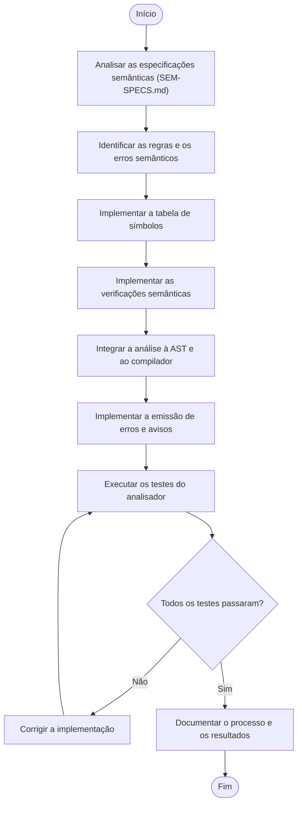

# Projeto e Implementação da Fase de Análise Semântica de um Compilador para a Linguagem TPP em Rust

**Autor:** Éric Seles Lourenço  
**Instituição:** Universidade Tecnológica Federal do Paraná (UTFPR)  
**Disciplina:** OPT011 — Implementação de Linguagens de Programação  

---

## Resumo

Este artigo apresenta o projeto e a implementação da fase de análise semântica de um compilador para a linguagem didática **TPP**, utilizando a linguagem de programação **Rust** (**RustCompiler**). A análise semântica é uma etapa crucial no processo de compilação, responsável por verificar a correção estática do código-fonte além da estrutura sintática, garantindo que declarações, escopos, tipos, arranjos e chamadas de funções estejam em conformidade com as regras da linguagem. O trabalho detalha a arquitetura modular do analisador semântico (`symbol_table.rs`, `sema.rs`, `rules/functions.rs` e `SemaErrorMessages.properties`), a construção da Árvore Sintática Abstrata Podada e Anotada (ASTO) e a emissão padronizada de erros e avisos. Por fim, a implementação é avaliada frente à suíte de testes de integração e aos casos de teste de referência da disciplina.

**Palavras-chave:** Compiladores, Análise Semântica, Tabela de Símbolos, Linguagem TPP, Rust, ASTO.

---

## 1. Introdução

A análise semântica é uma das fases mais importantes do processo de compilação, pois é responsável por verificar a correção semântica do código-fonte (Aho et al., 2008; Louden, 2004). Ela garante que as operações, declarações e expressões estejam de acordo com as regras da linguagem, identificando inconsistências que não podem ser detectadas nas fases léxica e sintática — como uso de variáveis não declaradas, incompatibilidades de tipos, aridade incorreta em chamadas de funções e indexação inválida de arranjos.

O presente trabalho tem como objetivo projetar e implementar a fase de análise semântica de um compilador para a linguagem **TPP**, utilizando a linguagem de programação **Rust**. Para isso, utilizou-se como base a estrutura do compilador de referência em Python fornecida na disciplina, bem como o documento de especificação `SEM-SPECS.md`, que define os erros e avisos tratados pela fase semântica da linguagem TPP (incluindo extensões da gramática TPP v1.1, como retornos múltiplos, atribuições múltiplas e tuplas).

Como resultado, o módulo semântico desenvolvido é capaz de validar programas escritos em TPP, reportar diagnósticos padronizados tanto por chave simbólica (`-k`) quanto em mensagens legíveis em português, e produzir uma Árvore Sintática Abstrata Podada e Anotada (ASTO) pronta para a etapa subsequente de geração de código.

---

## 2. Metodologia

O desenvolvimento da fase de análise semântica seguiu uma abordagem iterativa e orientada às especificações da disciplina, conforme ilustrado no fluxo abaixo:



### 2.1. Análise do arquivo `SEM-SPECS.md`

O processo de desenvolvimento iniciou-se pela leitura e categorização detalhada do arquivo `SEM-SPECS.md`, que formaliza os erros e avisos semânticos da linguagem TPP. As principais categorias de verificação implementadas abrangem:

1. **Funções e procedimentos:** verificação de declaração obrigatória da função `principal`, proibição de chamada externa à função `principal` (e aviso para chamada recursiva), verificação de existência da função chamada, validação de aridade (número menor ou maior de argumentos) e detecção de funções declaradas e não utilizadas.
2. **Variáveis e escopo:** validação de declaração prévia antes do uso, resolução de escopo local e global, aviso de redeclaração no mesmo escopo e detecção de variáveis não inicializadas ou não utilizadas.
3. **Compatibilidade de tipos e coerções implícitas:** verificação de compatibilidade entre tipos em atribuições, retornos e passagens de argumentos. Quando ocorre coerção implícita entre `inteiro` e `flutuante`, o compilador emite um aviso (*warning*) específico ao contexto (variável, expressão, literal numérico, retorno ou argumento).
4. **Arranjos:** validação de que os índices utilizados são do tipo `inteiro` e estão dentro dos limites declarados quando estáticos, além do registro das dimensões na tabela de símbolos (`0` dimensões para escalar, `1` para vetor, `2` para matriz, etc.) e validação de inicializadores de arranjo.
5. **Atribuições múltiplas, encadeadas e tuplas:** verificação da correspondência entre a quantidade de alvos e valores em atribuições múltiplas, validação de alvos atribuíveis e restrição do uso de tuplas fora dos contextos permitidos.
6. **Retornos múltiplos:** suporte a funções que declaram múltiplos tipos de retorno — como `(inteiro, inteiro) funct(inteiro: a, inteiro: b)` — e retornam múltiplos valores via `retorna(q, r)`, validando a quantidade e a compatibilidade dos tipos retornados.
7. **Expressões:** inferência e checagem de tipos em expressões aritméticas, relacionais, lógicas e unárias, além de avisos para comparações encadeadas (ex.: `1 < 2 < 3`) e expressões usadas como comando sem efeito.

### 2.2. Estrutura do Analisador Semântico

O módulo semântico (`src/tppsemantic/`) foi organizado em arquivos com responsabilidades bem definidas:

- **`mod.rs`:** define a interface pública do módulo `tppsemantic`, exportando os submódulos `rules`, `sema` e `symbol_table`.
- **`symbol_table.rs`:** implementa a tabela de símbolos e a representação de tipos (`TppType`), variáveis (`VarSymbol`) e funções (`FuncSymbol`), controlando escopos globais e locais.
- **`sema.rs`:** implementa o núcleo do analisador semântico, percorrendo a AST, gerenciando o contexto de diagnósticos (`SemaContext`), verificando tipos e expressões, e gerando a AST Podada e Anotada (`build_pruned_ast`).
- **`rules/mod.rs` e `rules/functions.rs`:** isolam verificações específicas pós-varredura sobre funções, como a existência obrigatória de `principal` e a detecção de funções declaradas e não utilizadas.
- **`SemaErrorMessages.properties`:** centraliza os modelos de mensagens de erro e aviso semântico indexados por chaves padronizadas (`ERR-SEM-*` e `WAR-SEM-*`).

---

## 3. Implementação Detalhada

### 3.1. Tabela de Símbolos (`symbol_table.rs`)

A tabela de símbolos é a estrutura central da análise semântica, armazenando informações sobre variáveis, funções e procedimentos, seus tipos, dimensões e escopos.

```rust
use std::collections::HashMap;

// Tipos de dados suportados pela TPP
#[derive(Debug, Clone, Copy, PartialEq, Eq)]
pub enum TppType {
    Inteiro,
    Flutuante,
    Vazio,
}
```

A enumeração `TppType` representa os tipos suportados pela linguagem TPP (`Inteiro`, `Flutuante` e `Vazio`), oferecendo métodos auxiliares de conversão entre a representação interna e textual:

```rust
// Implementação de métodos para TppType
impl TppType {
    pub fn from_str(type_str: &str) -> Option<TppType> {
        match type_str.to_ascii_lowercase().as_str() {
            "inteiro" => Some(TppType::Inteiro),
            "flutuante" => Some(TppType::Flutuante),
            "vazio" => Some(TppType::Vazio),
            _ => None,
        }
    }

    pub fn as_str(&self) -> &'static str {
        match self {
            TppType::Inteiro => "inteiro",
            TppType::Flutuante => "flutuante",
            TppType::Vazio => "vazio",
        }
    }
}
```

Os símbolos de variáveis e funções são modelados pelas estruturas `VarSymbol` e `FuncSymbol`:

```rust
// Estrutura para armazenar informações sobre variáveis
#[derive(Debug, Clone)]
pub struct VarSymbol {
    pub name: String,
    pub var_type: TppType,
    pub dimensions: Vec<Option<usize>>,
    pub scope: String,
    pub initialized: bool,
    pub used: bool,
    pub line: usize,
    pub column: usize,
}

// Estrutura para armazenar informações sobre funções
#[derive(Debug, Clone)]
pub struct FuncSymbol {
    pub name: String,
    pub return_types: Vec<TppType>, // Vec para suportar retorno múltiplo da TPP v1.1
    pub params: Vec<VarSymbol>,
    pub used: bool,
    pub line: usize,
    pub column: usize,
}
```

Nessas estruturas, cada campo desempenha um papel específico na verificação semântica:
- `name`: identificador da variável ou da função.
- `var_type`: tipo base da variável em `VarSymbol`.
- `return_types`: lista de tipos de retorno em `FuncSymbol`, permitindo representar procedimentos (`Vazio`), funções com retorno único e funções com retorno múltiplo.
- `dimensions`: vetor que registra as dimensões de uma variável em `VarSymbol` (vazio para escalares e com um elemento por dimensão para vetores e matrizes).
- `scope`: escopo da variável (`"global"` ou o nome da função em que foi declarada).
- `params`: vetor de parâmetros declarados em `FuncSymbol`.
- `initialized` e `used`: sinalizadores de controle para emissão de avisos de variáveis não inicializadas ou não utilizadas.
- `line` e `column`: posição de declaração no código-fonte para precisão nos diagnósticos.

A estrutura `SymbolTable` separa os símbolos em três tabelas de espalhamento (`HashMap`):

```rust
// Estrutura para armazenar a tabela de símbolos
#[derive(Debug, Clone, Default)]
pub struct SymbolTable {
    pub global_vars: HashMap<String, VarSymbol>,
    pub local_vars: HashMap<String, HashMap<String, VarSymbol>>, // Escopo -> (Nome da variável -> VarSymbol)
    pub functions: HashMap<String, FuncSymbol>,
}
```

Os métodos de `SymbolTable` garantem unicidade de declarações por escopo e resolução hierárquica (priorizando o escopo local antes de recorrer ao escopo global):

```rust
impl SymbolTable {
    pub fn new() -> Self {
        SymbolTable {
            global_vars: HashMap::new(),
            local_vars: HashMap::new(),
            functions: HashMap::new(),
        }
    }

    // Declara uma variável na tabela de símbolos, verificando se já foi declarada no mesmo escopo
    pub fn declare_variable(&mut self, var: VarSymbol) -> Result<(), TppType> {
        if var.scope == "global" {
            if let Some(existing) = self.global_vars.get(&var.name) {
                return Err(existing.var_type);
            }
            self.global_vars.insert(var.name.clone(), var);
        } else {
            let scope_vars = self.local_vars.entry(var.scope.clone()).or_insert_with(HashMap::new);
            if let Some(existing) = scope_vars.get(&var.name) {
                return Err(existing.var_type);
            }
            scope_vars.insert(var.name.clone(), var);
        }
        Ok(())
    }

    // Declara uma função na tabela de símbolos, verificando se já foi declarada
    pub fn declare_function(&mut self, func: FuncSymbol) -> Result<(), TppType> {
        if let Some(existing) = self.functions.get(&func.name) {
            return Err(existing.return_types.first().copied().unwrap_or(TppType::Vazio));
        }
        self.functions.insert(func.name.clone(), func);
        Ok(())
    }

    // Recupera uma variável da tabela de símbolos, considerando o escopo
    pub fn get_variable(&self, name: &str, scope: &str) -> Option<&VarSymbol> {
        if scope != "global" {
            if let Some(scope_vars) = self.local_vars.get(scope) {
                if let Some(var) = scope_vars.get(name) {
                    return Some(var);
                }
            }
        }
        self.global_vars.get(name)
    }

    // Recupera uma variável mutável da tabela de símbolos, considerando o escopo
    pub fn get_variable_mut(&mut self, name: &str, scope: &str) -> Option<&mut VarSymbol> {
        if scope != "global" {
            if let Some(scope_vars) = self.local_vars.get_mut(scope) {
                if let Some(var) = scope_vars.get_mut(name) {
                    return Some(var);
                }
            }
        }
        self.global_vars.get_mut(name)
    }

    // Recupera uma função da tabela de símbolos
    pub fn get_function(&self, name: &str) -> Option<&FuncSymbol> {
        self.functions.get(name)
    }

    // Recupera uma função mutável da tabela de símbolos
    pub fn get_function_mut(&mut self, name: &str) -> Option<&mut FuncSymbol> {
        self.functions.get_mut(name)
    }
}
```

### 3.2. Núcleo da Análise e Poda da AST (`sema.rs` e `rules/functions.rs`)

O arquivo `sema.rs` coordena a análise semântica a partir da função `analyze`, que recebe a AST produzida pelo parser e o sinalizador `check_key` (que alterna entre emissão de chaves de erro/aviso para testes automatizados e mensagens formatadas para o usuário):

```rust
/// Resultado da análise semântica.
pub struct SemaResult {
    pub table: SymbolTable,
    pub messages: Vec<String>,
    pub has_errors: bool,
    pub pruned_ast: AstNode,
}

/// Executa a análise semântica sobre a AST produzida pelo parser.
pub fn analyze(ast: &AstNode, check_key: bool) -> SemaResult {
    let mut table = SymbolTable::new();
    let mut sema = SemaContext::new(check_key);

    visit_node(ast, "global", &[], &mut table, &mut sema);

    rules::functions::verificar(ast, &mut table, &mut sema);
    check_unused_variables(&table, &mut sema);

    let pruned_ast = build_pruned_ast(ast, "global", &table);

    SemaResult {
        table,
        messages: sema.messages,
        has_errors: sema.has_errors,
        pruned_ast,
    }
}
```

Após a travessia principal (`visit_node`), o analisador delega a `rules::functions::verificar` a checagem global da existência da função `principal` (`ERR-SEM-MAIN-NOT-DECL`) e a verificação de funções não utilizadas (`WAR-SEM-FUNC-DECL-NOT-USED`), seguida pela checagem de variáveis não utilizadas (`check_unused_variables`).

Em seguida, `build_pruned_ast` constrói a **Árvore Sintática Abstrata Podada e Anotada (ASTO)**, simplificando nós estruturais redundantes e anotando nós de expressão e literais com seus tipos inferidos:

```rust
/// Gera a Árvore Sintática Abstrata Podada e Anotada (ASTO) para facilitar a geração de código.
pub fn build_pruned_ast(node: &AstNode, scope: &str, table: &SymbolTable) -> AstNode {
    let next_scope = if node.node_type == "Cabecalho" {
        node.children
            .first()
            .and_then(parse_id_label)
            .unwrap_or(scope)
    } else {
        scope
    };

    // Colapsa wrappers de lista com apenas 1 filho (ex.: ListaExpressoes / ListaAlvos)
    if (node.node_type == "ListaExpressoes" || node.node_type == "ListaAlvos")
        && node.children.len() == 1
    {
        return build_pruned_ast(&node.children[0], next_scope, table);
    }

    let pruned_children: Vec<AstNode> = node
        .children
        .iter()
        .filter(|c| {
            !((c.node_type == "ListaParametros" || c.node_type == "ListaArgumentos")
                && c.children.is_empty())
        })
        .map(|c| build_pruned_ast(c, next_scope, table))
        .collect();

    let label = if let Some((tok_type, val)) = parse_literal_info(node) {
        let ty = match tok_type {
            "NUM_INTEIRO" => "inteiro",
            _ => "flutuante",
        };
        format!("Literal: {} [{}]", val, ty)
    } else if let Some(rest) = node.node_type.strip_prefix("Operator: ") {
        if let Some(op_val) = extract_debug_field(rest, "value") {
            format!("Op: {}", op_val)
        } else {
            node.node_type.clone()
        }
    } else if matches!(
        node.node_type.as_str(),
        "Var"
            | "ChamadaFuncao"
            | "ExpressionAdditive"
            | "ExpressionMultiplicative"
            | "ExpressionRelational"
            | "ExpressionLogic"
            | "ExpressionUnary"
    ) {
        if let Some(inferred) = infer_expr_type(node, next_scope, table) {
            format!("{} [{}]", node.node_type, inferred.as_str())
        } else {
            node.node_type.clone()
        }
    } else {
        node.node_type.clone()
    };

    AstNode::with_position(label, node.line, node.column, pruned_children)
}
```

### 3.3. Catálogo de Diagnósticos (`SemaErrorMessages.properties`)

O arquivo `SemaErrorMessages.properties` define 32 mensagens padronizadas entre erros fatais (`ERR-SEM-*`) e avisos (`WAR-SEM-*`). A Tabela 1 resume as principais categorias de diagnóstico implementadas:

| Categoria | Chaves Representativas | Descrição |
| :--- | :--- | :--- |
| **Função `principal`** | `ERR-SEM-MAIN-NOT-DECL`, `ERR-SEM-CALL-FUNC-MAIN-NOT-ALLOWED`, `WAR-SEM-CALL-REC-FUNC-MAIN` | Garante a presença de `principal`, bloqueia chamadas externas e alerta sobre recursão. |
| **Chamadas e Retornos** | `ERR-SEM-CALL-FUNC-NOT-DECL`, `ERR-SEM-CALL-FUNC-WITH-FEW-ARGS`, `ERR-SEM-CALL-FUNC-WITH-MANY-ARGS`, `ERR-SEM-FUNC-RET-TYPE-ERROR`, `ERR-SEM-FUNC-RET-NUM-ERROR`, `ERR-SEM-CALL-FUNC-MULTI-RET-IN-EXP` | Valida existência, aridade, tipos/quantidade de retorno e uso indevido de retorno múltiplo em expressões. |
| **Variáveis e Escopo** | `ERR-SEM-VAR-NOT-DECL`, `WAR-SEM-VAR-DECL-PREV`, `WAR-SEM-VAR-DECL-NOT-INIT`, `WAR-SEM-VAR-DECL-NOT-USED`, `WAR-SEM-VAR-DECL-INIT-NOT-USED` | Detecta variáveis não declaradas, redeclarações e variáveis sem inicialização ou uso. |
| **Coerções Implícitas** | `WAR-SEM-ATR-DIFF-TYPES-IMP-COERC-OF-VAR`, `..._OF-EXP`, `..._OF-RET-VAL`, `..._OF-NUM`, `..._OF-FUNC-ARG` | Alerta quando há conversão implícita entre `inteiro` e `flutuante`. |
| **Arranjos** | `ERR-SEM-ARRAY-INDEX-NOT-INT`, `ERR-SEM-ARRAY-INDEX-OUT-OF-RANGE`, `ERR-SEM-ARRAY-INIT-DIM`, `ERR-SEM-ARRAY-INIT-IN-EXP`, `WAR-SEM-ARRAY-INIT-EXCESS-ELEMS` | Valida índices inteiros, limites estáticos e dimensões de inicializadores. |
| **Atribuições e Expressões** | `ERR-SEM-ATR-INVALID-TARGET`, `ERR-SEM-ATR-DIFF-NUM-TARGETS-VALUES`, `ERR-SEM-TUPLE-NOT-ALLOWED`, `WAR-SEM-EXP-STMT-NO-EFFECT`, `WAR-SEM-REL-CHAIN` | Verifica alvos válidos, atribuições múltiplas, tuplas inválidas e comparações encadeadas. |

**Tabela 1:** Principais categorias de erros e avisos semânticos suportados pelo analisador.

---

## 4. Resultados e Validação Experimental

### 4.1. Exemplo de Diagnóstico Semântico

Para o programa TPP abaixo, em que a variável `y` não foi declarada, a função `principal` está ausente e `foo` não é utilizada:

```tpp
inteiro foo()
    inteiro: x
    x := y
    retorna(x)
fim
```

Ao executar o compilador com a opção `--sema on`, o analisador reporta as chaves semânticas (com `-k`) ou as mensagens traduzidas para leitura humana:

```text
Variável 'y' não declarada.
Função 'principal' não declarada.
Função 'foo' declarada, mas não utilizada.
```

### 4.2. Exemplo de Poda e Anotação da AST (ASTO)

Para a expressão `a := 1 + 2.5` dentro de `principal` (com `inteiro: a`), a função `build_pruned_ast` remove nós estruturais vazios (como `ListaParametros` sem parâmetros) e anota os nós relevantes com seus tipos inferidos e operadores normalizados:

- `ExpressionAdditive [flutuante]`
- `Literal: 1 [inteiro]`
- `Op: +`
- `Literal: 2.5 [flutuante]`
- `Var [inteiro]`

### 4.3. Resultados nos Testes de Integração

A validação foi conduzida por meio da suíte `tests/tppsema_test.rs`, executada via `cargo test --test tppsema_test`:

- **Testes unitários e de CLI do módulo semântico:** **5 de 5** testes específicos passaram integralmente (`cli_sema_programa_valido_sem_erros`, `cli_sema_reporta_chaves_e_mensagens_formatadas`, `sema_valida_chamadas_principal_e_aridade`, `sema_valida_comparacao_encadeada_e_tupla_invalida` e `sema_gera_ast_podada_e_anotada`).
- **Suíte oficial de referência (`tests/sem-tests/`):** **18 de 20** programas de teste obtiveram correspondência exata com os arquivos `.sem.out` esperados. Nos **2 casos divergentes** (`sem-test-006.tpp` e `sem-test-007.tpp`), os erros semânticos principais (como `ERR-SEM-FUNC-RET-TYPE-ERROR` e `WAR-SEM-VAR-DECL-PREV`) foram corretamente detectados, havendo apenas divergência na granularidade de avisos de inicialização e uso de variáveis (`WAR-SEM-VAR-DECL-INIT-NOT-USED`, `WAR-SEM-VAR-DECL-NOT-INIT` e `WAR-SEM-VAR-DECL-NOT-USED`).

---

## 5. Conclusão

A implementação da fase de análise semântica do `RustCompiler` consolidou a verificação estática de programas escritos na linguagem TPP em Rust. A combinação de uma tabela de símbolos fortemente tipada (`SymbolTable`) com uma travessia modular da AST e um catálogo externo de mensagens (`SemaErrorMessages.properties`) permitiu detectar erros de escopo, tipagem, arranjos, chamadas de funções e recursos da TPP v1.1 (como retornos múltiplos e tuplas), além de gerar a Árvore Sintática Abstrata Podada e Anotada (ASTO).

---

## Referências Bibliográficas

- **COOPER, Keith D.; TORCZON, Linda.** *Construindo compiladores*. Rio de Janeiro: Elsevier/Campus, 2014.
