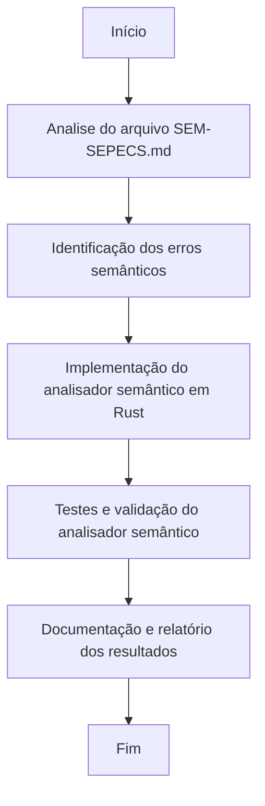

# Projeto e Implementação da Fase de Análise Semântica de um Compilador para a Linguagem TPP em Rust

**Autor:** Éric Seles Lourenço  
**Instituição:** Universidade Tecnológica Federal do Paraná (UTFPR)  
**Disciplina:** OPT011 — Implementação de Linguagens de Programação  

---

# Resumo

Este artigo apresenta o projeto e a implementação da fase de análise semântica de um compilador para a linguagem TPP, utilizando a linguagem de programação Rust. A análise semântica é uma etapa crucial no processo de compilação, responsável por verificar a correção semântica do código-fonte, garantindo que as operações e expressões estejam de acordo com as regras da linguagem. O trabalho aborda os desafios enfrentados durante a implementação, a arquitetura da solução e os resultados obtidos com a aplicação do compilador em programas escritos em TPP.

# Introdução

A análise semântica é uma das fases mais importantes do processo de compilação, pois é responsável por verificar a correção semântica do código-fonte. Ela garante que as operações e expressões estejam de acordo com as regras da linguagem, identificando erros semânticos que não podem ser detectados em fases anteriores. O presente trabalho tem como objetivo desenvolver e implementar a fase de análise semântica de um compilador para a linguagem TPP, utilizando a linguagem de programação Rust.
Para isso, foi utilizado como base a estrutura do compilador já existente em python dado pelo professor. Além disso, foi utilizado o arquivo markdown `SEM-SEPECS.md` como referência para criação do analisador semântico, que contém as especificações dos erros tratados na fase semântica da linguagem TPP. 
Como resultado, o compilador desenvolvido é capaz de identificar e reportar erros semânticos em programas escritos em TPP, garantindo a conformidade com as regras da linguagem e contribuindo para a melhoria da qualidade do código-fonte.

# Metodologia

O seguinte trabalho foi realizado em etapas, seguindo uma abordagem estruturada para o desenvolvimento da fase de análise semântica do compilador:



## Análise do arquivo SEM-SEPECS.md

O processo de desenvolvimento envolveu a análise detalhada do arquivo `SEM-SEPECS.md`, que contém as especificações dos erros semânticos da linguagem TPP. A partir dessa análise, foram identificados os tipos de erros que o compilador deve detectar e reportar. As principais categorias de erros semânticos abordadas incluem:

1. **Funções e procedimentos:** verificar aspectos relacionados à declaração e ao uso de funções e procedimentos.
2. **Variáveis:** verificar a declaração, o escopo e o tipo das variáveis.
3. **Compatibilidade de tipos e coerções implícitas:** verificar se os tipos envolvidos em uma atribuição são compatíveis. Quando ocorrer uma coerção implícita entre valores inteiros e de ponto flutuante, o compilador deverá emitir um aviso (*warning*).
4. **Arranjos:** verificar se os índices são inteiros. A tabela de símbolos também deverá registrar se cada variável é escalar ou um arranjo e, neste último caso, sua quantidade de dimensões: `0` para escalar, `1` para vetor, `2` para matriz, e assim por diante.
5. **Atribuições múltiplas, encadeadas e tuplas:** verificar as situações relacionadas a essas formas de atribuição.
6. **Retornos múltiplos:** permitir que uma função declare vários tipos de retorno, como em `funct(inteiro: a, inteiro: b)`, e retorne vários valores, como em `retorna(q, r)`.
7. **Expressões:** verificar os aspectos semânticos relacionados às expressões.
8. **Outras situações:** considerar também os casos descritos nos arquivos de teste.

## Estrutura do Analisador Semântico

A estrutura do analisador foi dividida em arquivos onde cada um ficou responsável por uma parte específica da análise semântica.

- **Arquivo `sema.rs`:** Contém a implementação do analisador semântico, incluindo funções para verificar a conformidade semântica do código-fonte.
- **Arquivo `symbol_table.rs`:** Implementa a tabela de símbolos, que armazena informações sobre variáveis, funções e procedimentos, incluindo seus tipos e escopos.
- **Arquivo `SemaErrorMessages.properties`:** Contém as mensagens de erro semântico que serão exibidas ao usuário quando um erro for detectado.
- **Arquivo `mod.rs`:** Define os módulos do analisador semântico, permitindo a organização e a modularidade do código.

Detalhando cada arquivo:

Começando pelo arquivo `symbol_table.rs`, ele é responsável por gerenciar a tabela de símbolos, que é uma estrutura de dados fundamental para a análise semântica. A tabela de símbolos armazena informações sobre variáveis, funções e procedimentos, incluindo seus tipos, escopos e outras propriedades relevantes. Ela permite que o analisador semântico verifique a existência de variáveis e funções, bem como suas declarações e usos corretos.

```Rust
use std::collections::HashMap;

// Tipos de dados suportados pela TPP
#[derive(Debug, Clone, Copy, PartialEq, Eq)]
pub enum TppType {
    Inteiro,
    Flutuante,
    Vazio,
}
```
A enumeração `TppType` define os tipos de dados suportados pela linguagem TPP, incluindo `Inteiro`, `Flutuante` e `Vazio`. Essa enumeração é utilizada para representar o tipo de uma variável ou o tipo de retorno de uma função.

```Rust
// Estrutura para armazenar informações sobre variáveis
#[derive(Debug, Clone)]
pub struct VarSymbol {
    pub name: String,
    pub var_type: TppType,
    pub dimensions: Vec<Option<usize>>,
    pub scope: String,
    pub initialized: bool,
    pub used: bool,
    pub line: usize,
    pub column: usize,
}

// Estrutura para armazenar informações sobre funções
#[derive(Debug, Clone)]
pub struct FuncSymbol {
    pub name: String,
    pub return_types: Vec<TppType>, // Vec para suportar retorno múltiplo da TPP v1.1
    pub params: Vec<VarSymbol>,
    pub used: bool,
    pub line: usize,
    pub column: usize,
}
```
As estruturas `VarSymbol` e `FuncSymbol` armazenam informações sobre variáveis e funções, respectivamente. Onde cada campo representa propriedades relevantes:
- `name`: Nome da variável ou função. Para variáveis, é o identificador da variável, e para funções, é o nome da função.
- `var_type`: Tipo da variável (para `VarSymbol`) ou tipos de retorno (para `FuncSymbol`).
- `dimensions`: Vetor que indica as dimensões de uma variável (para `VarSymbol`), permitindo representar variáveis escalares, vetores e matrizes.
- `scope`: Escopo da variável (para `VarSymbol`), indicando se é global ou local.
- `params`: Vetor de parâmetros da função (para `FuncSymbol`).
- `initialized`: Indica se a variável foi inicializada.
- `used`: Indica se a variável foi utilizada.
- `line`: Número da linha onde a variável foi declarada.
- `column`: Número da coluna onde a variável foi declarada.

```Rust
// Estrutura para armazenar a tabela de símbolos
#[derive(Debug, Clone, Default)]
pub struct SymbolTable {
    pub global_vars: HashMap<String, VarSymbol>,
    pub local_vars: HashMap<String, HashMap<String, VarSymbol>>, // Escopo -> (Nome da variável -> VarSymbol)
    pub functions: HashMap<String, FuncSymbol>,
}
```
A estrutura `SymbolTable` representa a tabela de símbolos, que é composta por três campos principais:
- `global_vars`: Um `HashMap` que armazena variáveis globais, onde a chave é o nome da variável e o valor é um `VarSymbol` correspondente.
- `local_vars`: Um `HashMap` que armazena variáveis locais, onde a chave é o escopo da variável e o valor é outro `HashMap` que mapeia o nome da variável para o `VarSymbol` correspondente.
- `functions`: Um `HashMap` que armazena funções, onde a chave é o nome da função e o valor é um `FuncSymbol` correspondente.

```Rust
// Implementação de métodos para TppType
impl TppType {
    pub fn from_str(type_str: &str) -> Option<TppType> {
        match type_str.to_ascii_lowercase().as_str() {
            "inteiro" => Some(TppType::Inteiro),
            "flutuante" => Some(TppType::Flutuante),
            "vazio" => Some(TppType::Vazio),
            _ => None,
        }
    }

    pub fn as_str(&self) -> &'static str {
        match self {
            TppType::Inteiro => "inteiro",
            TppType::Flutuante => "flutuante",
            TppType::Vazio => "vazio",
        }
    }
}
```
A implementação de métodos para `TppType` inclui funções auxiliares para converter entre strings e os tipos de dados da TPP. O método `from_str` converte uma string em um `TppType`, enquanto o método `as_str` retorna a representação em string de um `TppType`.

```Rust
// Implementação de métodos para SymbolTable
impl SymbolTable {
    pub fn new() -> Self {
        SymbolTable {
            global_vars: HashMap::new(),
            local_vars: HashMap::new(),
            functions: HashMap::new(),
        }
    }

    // Declara uma variável na tabela de símbolos, verificando se já foi declarada no mesmo escopo
    pub fn declare_variable(&mut self, var: VarSymbol) -> Result<(), TppType> {
        if var.scope == "global" {
            if let Some(existing) = self.global_vars.get(&var.name) {
                return Err(existing.var_type);
            }
            self.global_vars.insert(var.name.clone(), var);
        } else {
            let scope_vars = self.local_vars.entry(var.scope.clone()).or_insert_with(HashMap::new);
            if let Some(existing) = scope_vars.get(&var.name) {
                return Err(existing.var_type);
            }
            scope_vars.insert(var.name.clone(), var);
        }
        Ok(())
    }

    // Declara uma função na tabela de símbolos, verificando se já foi declarada
    pub fn declare_function(&mut self, func: FuncSymbol) -> Result<(), TppType> {
        if let Some(existing) = self.functions.get(&func.name) {
            return Err(existing.return_types.first().copied().unwrap_or(TppType::Vazio));
        }
        self.functions.insert(func.name.clone(), func);
        Ok(())
    }

    // Recupera uma variável da tabela de símbolos, considerando o escopo
    pub fn get_variable(&self, name: &str, scope: &str) -> Option<&VarSymbol> {
        if scope != "global" {
            if let Some(scope_vars) = self.local_vars.get(scope) {
                if let Some(var) = scope_vars.get(name) {
                    return Some(var);
                }
            }
        }
        self.global_vars.get(name)
    }

    // Recupera uma variável mutável da tabela de símbolos, considerando o escopo
    pub fn get_variable_mut(&mut self, name: &str, scope: &str) -> Option<&mut VarSymbol> {
        if scope != "global" {
            if let Some(scope_vars) = self.local_vars.get_mut(scope) {
                if let Some(var) = scope_vars.get_mut(name) {
                    return Some(var);
                }
            }
        }
        self.global_vars.get_mut(name)
    }

    // Recupera uma função da tabela de símbolos
    pub fn get_function(&self, name: &str) -> Option<&FuncSymbol> {
        self.functions.get(name)
    }

    // Recupera uma função mutável da tabela de símbolos
    pub fn get_function_mut(&mut self, name: &str) -> Option<&mut FuncSymbol> {
        self.functions.get_mut(name)
    }
}
```
O `impl SymbolTable` fornece métodos para declarar e recuperar variáveis e funções na tabela de símbolos. Ele garante que as declarações sejam únicas dentro do mesmo escopo e permite a recuperação de informações sobre variáveis e funções, considerando o escopo apropriado.

Com a tabela de símbolos implementada, podemos passar ao arquivo `sema.rs`, núcleo do analisador semântico. Ele percorre a árvore de sintaxe abstrata (AST), gerada durante a análise sintática, e utiliza a tabela para verificar se o código-fonte está de acordo com as regras da linguagem TPP, identificando problemas como variáveis não utilizadas, incompatibilidades de tipos e uso incorreto de funções e procedimentos.

Podemos pegar como exemplo a função `check_unused_variables`:
```Rust
fn check_unused_variables(table: &SymbolTable, sema: &mut SemaContext) {
    for var in table.global_vars.values() {
        emit_unused_var(var, sema);
    }
    for scope_vars in table.local_vars.values() {
        for var in scope_vars.values() {
            emit_unused_var(var, sema);
        }
    }
}
```
Verifica se uma variável foi declarada mas não utilizada em nenhum ponto do código. Caso seja detectada uma variável não utilizada, o compilador emite uma mensagem de aviso ao usuário, incentivando a remoção de código desnecessário.


